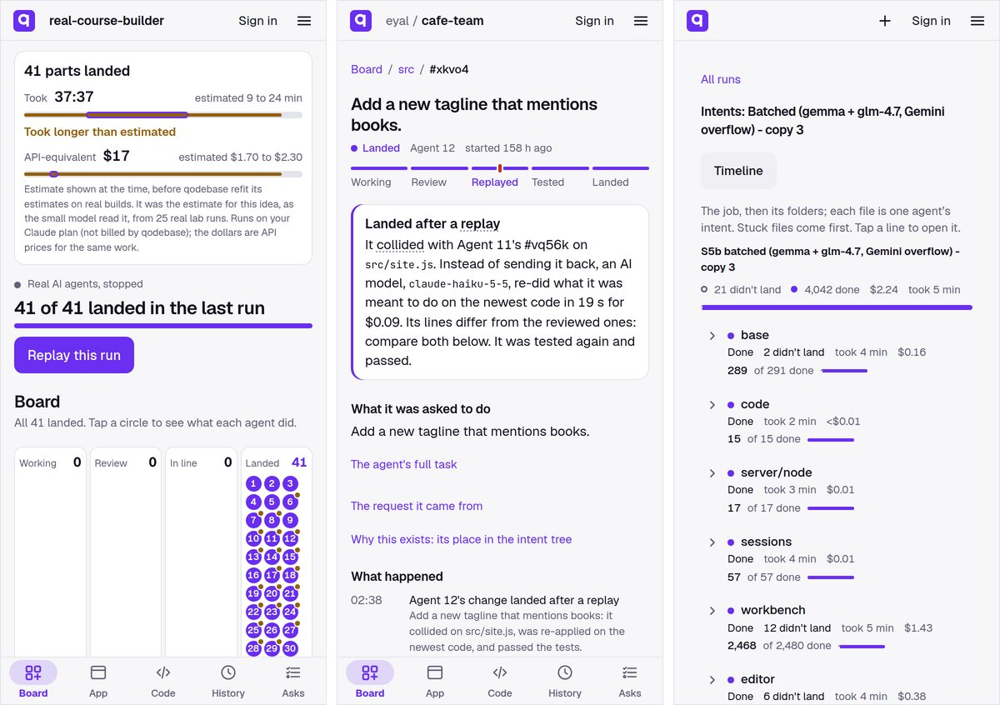
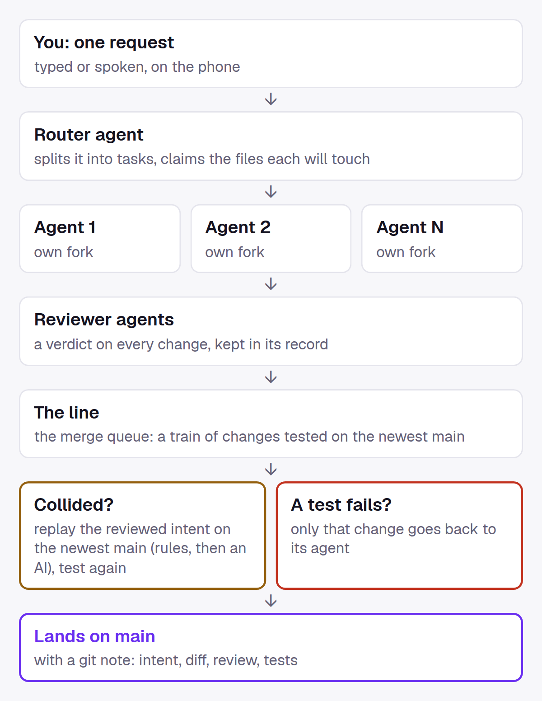

# qodebase

**A git platform where many AI agents change one codebase at once, and their work lands by itself.** Built entirely on Cloudflare, made to be used from a phone.

**What we proved, at two scales** (all on Cloudflare):
- **Thousands of agents:** 4,750 agents with cached answers landed 63,441 changes in under 3 minutes, with no errors; with real cheap models, a fleet landed 31,466 file changes in six real codebases, up to ~114 a second, none touching code.
- **Real Claude teams up to 40:** 28 of a 40-agent build's changes collided and were all redone by a model on the newest code; at this size, one strong agent finished sooner in 3 of 3 builds.

**What we found.** For building a fresh app, one strong agent is the measured default: on the same prompts, in 3 of 3 real builds, one strong agent finished sooner than a team (2×, 4× and 6×; the 6× pair, R8b, had a ~10 min queue bug), with at least as many features working; the team was cheaper in 2 of 3 (one build each: [R6 vs R3](docs/board/R3-R6-quality.md), [R7 vs R4](docs/board/R4-R7-quality.md), [R8b](docs/board/R8b-quality.md)). Many agents pay off for wide work (shared task lists, two teams on one repo, tasks arriving mid-run: the board), for work that has to run in parallel (big ports like Bun's), and at fleet scale (lanes, a fleet of cheap models). qodebase is the layer that makes many agents safe: every change an intent with a record, landed by intent on the newest code, with a live board and a timeline of who did what.

(Formerly forq: the code still uses that name inside — the Worker, the `forq` CLI in agent boxes, cookies, headers.)

**How it works, with the demo, the measurements and the simulations:** https://qodebase.app/how

**Watch it work, no sign-in:** open **https://qodebase.app/p/eyal/corner-cafe** and tap **Watch a run**. Six scripted agents (no AI) change a small café website at once for about a minute: real commits on their own forks, real collisions, real tests, through the real merge queue. It is staged: reviews are approved automatically and the tasks are ordered so the story happens. The run with real AI agents is below.

## With real AI agents

One request, typed on the phone ([eyal/cafe-team](https://qodebase.app/p/eyal/cafe-team), 2026-10-08):

- **12 real Claude Haiku 5.5 agents**, each on its own fork, plus 3 reviewer agents
- **12 of 12 changes landed in 6 min 43 s**, each reviewed once, none bounced
- **7 collisions**: 6 replayed by rules on shared files, 1 real conflict (two edits to the same line) re-done by an AI on the newest code in 19 s ([the change and its record](https://qodebase.app/p/eyal/cafe-team/work#/change/eyal.cafe-team--xkvo4))
- a bigger example from another build ([eyal/real-home-inventory-r8b, change 'Lent out: who has what'](https://qodebase.app/p/eyal/real-home-inventory-r8b/work#/change/eyal.real-home-inventory-r8b--isdhz)): its merge collided with another agent's change in app.js, README and styles.css; instead of sending it back, Claude Haiku 5.5 redid the loan feature on the newest code in 2 min for $0.62 (the active-loan lookup, an overdue check, borrower de-duplication, overdue-first sorting and the lend form), then the tests ran again and passed
- main: 13 commits, 12 git notes with the full record of each change, tests green
- real spend: **$0.16** of container time (the agents ran on a Claude subscription; API-equivalent ~$0.53)

**Bigger:** through the product's own Build path, up to 40 real Claude Haiku agents (an Opus planner, 3-6 reviewers, the board) built a travel planner inside qodebase ([eyal/real-course-builder](https://qodebase.app/p/eyal/real-course-builder); the project is called course-builder, but what it built is a travel planner):
- **41 changes landed**, every one through the landing queue with checks: the build's 40, and a 41st that wired two views the build left unwired (an agent wrote a view but never added its script tag, and review missed it; a check that a model replay keeps every line the reviewed change added, and a smoke check, are being added)
- **the app works for 11 of its 13 features** (each tried by hand at 390 px, [`R5-quality.md`](docs/board/R5-quality.md)): the cost splitter is missing: the model replay of its change (ag1dx) landed the CSS and the index.html line but dropped the reviewed view, `js/features/split.js`, so the math (`settle.js`) was never given a screen, and the tests missed it. Auditing all 35 replays afterwards (this build's 28 and R8b's 7), we found that one; replays now apply clean files directly, redo only conflicting files, and refuse to land if any reviewed file is missing ([`FINDINGS2.md`](docs/board/FINDINGS2.md) §11); and one cross-agent interface mismatch broke itinerary editing (one agent called the editor with an object, another defined it with positional arguments). As on the café site (R4), the team failed at the seams between agents
- **28 collided** with work that landed first; each was re-done by a model on the newest code, tested and landed; **none was sent back**
- at that size **review was the bottleneck**: agents spent 16,234 agent-seconds waiting for a reviewer against 15,731 working, even with 6 reviewers; next, the train ran model replays one after another
- 2,257 s wall (including a false budget halt, since fixed); $17.48 of model use at normal API rates (the agents ran on a Claude subscription; the merge queue's model replays, ~$0.21, were logged under a mistyped project key and are not in it), plus $0.88 of container time. Smaller builds and the bugs these runs found: [`docs/board/FINDINGS2.md`](docs/board/FINDINGS2.md) §11

**One agent or a team, on the same prompt** (real builds through Build, one build each, every feature tried by hand at 390 px; cost = model use at normal API rates from [`public/results.json`](public/results.json), container time not included):

| prompt | one Opus agent | team (Opus planner + Haiku coders + reviewers, board) | quality |
|---|---|---|---|
| Home inventory (Large) | R6: 457 s, $3.87 | R3: 1,940 s (~1,100-1,300 s without a false halt and a stall), $2.40; R8b, after fixes: 2,765 s (incl. a ~10 min queue bug), $4.41 | all 11 features in all three ([R6 vs R3](docs/board/R3-R6-quality.md), [R8b](docs/board/R8b-quality.md)) |
| Café website (Huge) | R7: 863 s, $7.55, 12 of 12 working | R4: 1,762 s, $3.32, 10 working + 2 partial (one agent stored the name as {en, pt}, others read a string) | [R7 vs R4](docs/board/R4-R7-quality.md) |

So Build now suggests one strong agent at every size; the team presets stay one tap away. A team was cheaper in R3 and R4 but not in R8b (its first run exposed a merge-queue bug, since fixed). Huge with one agent is R7 only.

## How it works

- **A fork per agent.** Agents never share a working folder, so they never trip over each other.
- **A record per change**: what it was meant to do, the diff, the reviewer's verdict, the tests. Kept with the code as git notes (`git log --notes=qodebase`), so the *why* survives.
- **The line (merge queue).** Approved changes wait in one line and land in tested trains. A failing change bounces alone; main never breaks.
- **Land by intent.** When a change collides with what landed since, the queue re-applies the reviewed intent on the newest code instead of sending the work back: rules for shared files (routes, package.json, lists, lockfiles), an AI for real conflicts (per-project switch), then the owner.
- **Claims.** Agents declare the files they will touch, so everyone sees who works where.
- **Stacking.** A change can build on one that has not landed yet; it lands right after it.

Not GitHub with agents on top: the unit is an intent with its record, and landing is automatic.

## What we measured first

No model calls in any of these; every number has its script.

| | finding |
|---|---|
| Hono's last 346 PRs, replayed as 100 at once | 48% needed another PR to land first; **0 git conflicts**. The problem is order. |
| A migration of Hono's code, many agents (simulation) | grabbing tasks in any order wasted **90 agent-hours**; knowing the order finished in less than half the time at 10 agents; stacking + land by intent wasted nothing |
| Real code (403 files), 500 scripted agents, real git + tests (simulation, scripted edits) | land by intent landed **3.5×** as many changes per hour as review-then-merge |
| 500 agents on Cloudflare (Durable Objects + Artifacts) | 7,033 pushes from 500 forks at once, 280 ms median; one merge queue was the limit (it reset three times, and a bug of ours caused 88 stale-ref rejections, since fixed) |

Details in [`sim/README.md`](sim/README.md), charts in [`docs/contest/evidence/`](docs/contest/evidence/), and the simulations to play with at https://qodebase.app/sim (all linked from https://qodebase.app/how).

## Built on Cloudflare

| | |
|---|---|
| **Workers** | the site, the API, every project's live app on its own address |
| **Durable Objects** | each project, its merge queue (Landing), every agent box, the scripted demo agents |
| **Artifacts** | git: a repo per project, a fork per agent, change records as git notes |
| **Containers** | agent boxes running Claude Code; the merger box that tests and lands trains |
| **Workers AI** | the fleet's models (with AI Gateway), Talk (speech in and out, the fast picker), the video's narration |

## Use it

- **On the phone:** https://qodebase.app. Explore, open a project, read code, fork. Signing in uses an emailed code; running agents needs your own Anthropic API key or Claude subscription token.
- **Command line / agents:** `curl -fsSL https://qodebase.app/cli/install.sh | sh`, then `qb login` (approve on your phone) and `qb help`. Agents read https://qodebase.app/llms.txt.
- **Ask for a change:** on someone else's public project, tap **Request a change**: one text box, an optional screenshot, an optional link to your fork. The owner sees it in the project's Requests tab (shown while requests wait; otherwise under More) and can send it to the project's agents (on the owner's budget), reply, or close it; you follow it under Your requests in the Inbox. Limits: 3 per project and 10 in all per person a day; private projects take none, and owners can turn them off.
- **Your own copy:** https://qodebase.app/own installs qodebase, merge queue and board included, into your own Cloudflare account in about 85 seconds (needs Workers Paid and Cloudflare Artifacts, in beta). Manual setup: [`SELF_HOST.md`](SELF_HOST.md); agent image: [`box/`](box/).

## Built vs designed

**Built and running**

- a fork per agent; router and reviewer agents
- change records, kept as git notes
- the merge queue with tested trains; a failing change bounces alone
- replay by rules; replay by AI behind a per-project switch
- claims and stacking (`forq spawn --files … --on …`)
- Talk (type or speak a request), Watch a run, replays of past runs
- the Intents tab: browse intents, not agents. The request at the top, then areas, then what each agent set out to do and the change it made; each line rolls up status (needs you, blocked, working, waiting, didn't land, done), counts, cost and time, needs-you first, and from any change "Why this exists" walks up to the request. A fleet run opens the same way, folder by folder ([a 40-agent build](https://qodebase.app/p/eyal/real-course-builder/work#/intents), [a 4,064-file fleet run](https://qodebase.app/runs#/intents/run/fleet-vscode-src-11/fmv6rzp4n))
- Requests, issues for the agent age: anyone signed in sends a public project's owner one short request (a screenshot and a link to their fork optional); the owner sends it to the agents, replies or closes it
- installing your own copy into your Cloudflare account

**Designed or simulated, not built yet**

- one merge queue per area of the code (lanes): simulated and run with scripted agents on Cloudflare, see below
- git notes shown in the code browser (today: on each change's page, and in git)
- a lead agent per area for conflicts no replay can solve: simulated in `sim/`; today the owner decides, and the demo uses a scripted lead

## Agent board: who works on what

Each project keeps a live board in its Landing Durable Object. Agents state their task, a hook posts their edits and commits, and finished work stays visible once it is on main. Before work starts, one duplicate check marks twin tasks on the list. Agents ask the board from their box (`forq who`, `forq intent`, `forq dedupe`); people watch it in Agents at work. What we tested is that bundle: **board + upfront duplicate check**.

Real Claude agents on synthetic task lists of short tasks, with duplicates we planted, sharing one git repo on a laptop and pushing straight to main with plain git (no landing queue). Without vs with, 3 runs each (medians):

| | wall | cost | built twice | hidden tests |
|---|---|---|---|---|
| 20 Haiku agents, 60 tasks | 594 → 451 s (−24%) | $3.26 → $2.73 (−16%) | 9 → median 0 (0–1) of 10 pairs | 60/60 both |
| 8 Sonnet agents, 16 bigger tasks | 275 → 189 s (−31%) | $7.54 → $5.49 (−27%) | 0 either way | 16/16 both |

- **How sure:** 3 runs vs 3 can't be significant on its own (no overlap gives p = 0.1). The same direction with no overlap appeared in four separate setups (10 Haiku, 20 Haiku, 8 Sonnet, and two teams on Cloudflare below): combined p ≈ 0.02 (Fisher). Hidden tests sit at the ceiling, so "same quality" means no difference detected. Costs are API-equivalent cost on the subscription.
- **Where the saving comes from:** mostly agents no longer building a task someone else is already building (~85% of the agent-minutes saved with 20 Haiku agents). Merge conflicts did not fall (they rose slightly); what fell were aborted rebases and resets.
- **The first version failed.** It counted committed-but-unpushed work as finished, so at 20 agents 3–4 tasks per run were skipped by everyone: 56/60 hidden tests, 1.7× slower. Three changes fixed it: *finished* means landed on main, no waiting (an agent that waits picks another task instead), and a turn cap of 60 instead of 40. The earliest claim now keeps a task.
- A cost: with the board, 20 Haiku agents left more red commits on main (median 3 vs 0 per run). These were hand-merged pushes made without running the tests; a later commit repaired each, and every final main was green. Inside qodebase this cannot reach main: the landing queue tests a change before it lands.
- **Growing the team** (150 tasks, Haiku, 3 runs each): a controller that adds agents while landings per minute rise, and steps back when they don't, settled at 10–14 agents. Against a fixed team of 40 it used about a quarter of the agent-minutes and about half the cost, and was not slower. Controller + board was the best arm (1,284 s, $4.73, 150/150 hidden tests in every run). The comparison with fixed teams of 8 and 20 was cut by the weekly usage stop, so whether the controller finds the best fixed size is untested ([`FINDINGS2.md`](docs/board/FINDINGS2.md) §8).
- Against simpler options (20 Haiku agents, 3 runs each): the same agents with the duplicate annotation but no board, and a static split rule (agent k takes every 20th task). The board was the only setup with no duplicate built twice (0 vs 3 and 7 of 10 pairs) and had the lowest median time and cost (443 s, $2.61 vs 505 and 549 s, $2.85 and $3.27); against the split rule, time and cost overlap (one split run was the fastest of all).
- Most parts exist elsewhere (MCP Agent Mail's leases, Beads' AI dedupe, Overstory's LLM merge tier, Claim Plane and Foremerge intents). The closest real-agent study, CooperBench (arXiv 2601.13295, ICLR 2026), found coding agents ~30% less successful when cooperating. We found no published A/B with real coding agents that reports wall time and cost for such a board, and no match for this combination ([`docs/board/prior-art.md`](docs/board/prior-art.md)).

**Inside qodebase, on Cloudflare** (6 Haiku agents in real boxes, the landing queue, without vs with the board + duplicate check, 3 runs per cell, medians; one run alone can't be significant, see above):

| | wall | cost | built twice (pairs of 5) |
|---|---|---|---|
| two teams on one repo (one duplicate check across both lists) | 775 → 465 s (−40%, no overlap) | $1.80 → $1.41 (−22%, no overlap) | 4, 4, 3 → 0, 0, 1 |
| one shared list, land by intent | 805 → 435 s (−46%, runs overlap) | $1.44 → $1.34 (no clear difference) | 0 both |
| one shared list, plain-git policy | 948 vs 1012 s: no difference | $3.06 vs $2.94: no difference | 1 both |

- Hidden tests: no difference detected in any cell. On the shared list under land by intent, no change bounced with the board (3, 5, 0 → 0, 0, 0).
- Under qodebase's plain-git policy the board made no difference: its bounces are rebase conflicts the board does not touch.
- The simulator's pre-registered prediction said the board would not save time under land by intent, so the −40% and −46% were a surprise. Without the board, agents on one shared list spotted the duplicate tasks already on main by themselves.
- Excluded tries: 3 without the board and 1 with it, each for a bug found while running. Real money $1.78 for the boxes; $42.6 API-equivalent cost on the subscription. Caveats: [`docs/board/FINDINGS2.md`](docs/board/FINDINGS2.md) sections 3 and 5.

Details: [`docs/board/FINDINGS2.md`](docs/board/FINDINGS2.md), [`docs/board/E6-results.md`](docs/board/E6-results.md).

## Lab results

**Which team shape works best?** The same job given to one strong agent, and to a planner with a crew of cheaper agents, through qodebase's queue (live: https://qodebase.app/lab).

| job | one Opus agent | Opus planner + Haiku crew |
|---|---|---|
| bakery site (median of 3 runs) | 509 s, 26/26, $4.08 | 987 s, 25/26, $1.75 |
| club site, a 15-minute job (median) | 728 s, 42/42, $5.71 | 1,184 s, 42/42, $2.96 |

- **On the two comparable jobs, one Opus agent was faster and the crew cost about half.** Opus was 1.9× faster on the bakery and 1.6× on the club; the crew cost 57% and 48% less at standard API prices. At the >100k-token-prompt price the crew costs more than Opus. Both passed every club test; on the bakery Opus passed 1 more.
- Times leave out runs stalled by the platform; with the stalled bakery run counted, Opus was 2.3× faster.
- The café and the TypeScript port were also run, but their runs are not comparable (the lab page says why); the port crew's $0.85 is a lower bound.
- **The crew is limited by how fast changes land** (one per ~60–100 s), not by how many agents work. The simulator, fitted to these runs within ~5%, predicts it stays slower even on a job four times wider; faster landing (shorter waits, bigger trains, more reviewers) is what would change that.
- Haiku as the planner under-plans: 1 and 3 of 7 hidden tests on the café.
- GitHub-style (pull requests merged one at a time) timed out after an hour with 3 of 6 tasks landed.

Hidden tests are never in the agents' repo; the 0–100 scores, which add build checks and an AI judge, are in each run ([`docs/lab/scoring.md`](docs/lab/scoring.md)). Times leave out runs stalled by the platform (one bakery and one club crew run); quality and cost use every run. Costs are API-equivalent at standard rates (the runs used a Claude subscription). Every run: [`public/lab/runs.jsonl`](public/lab/runs.jsonl); plan: [`docs/lab/`](docs/lab/).

**OpenClaw, a very busy open-source repo** (30 days of public data; [`docs/openclaw/FINDINGS.md`](docs/openclaw/FINDINGS.md)):

- ~16,000 commits on main, ~630 pull requests a day, and no merge queue: at their pace, their flow is the cheapest and fastest.
- A queue that tests each train's own scoped tests would cost ~1.6× their landing CI with an ~18-minute median wait; for ~78% of full-suite breaks, a change in the failing test's area landed that hour, so scoped trains would plausibly catch them.
- Triage: a Haiku agent that reads the repo and the issue index was right on 61% of 200 issues vs 50% for text-only (p = 0.004), and found 66% of duplicates vs 14%.
- Putting the project's own triage policy files into the prompt did not help (55% vs 58.5%, p = 0.13).

## Different jobs need different ways to run agents

No one way of running agents won everywhere. What won, by the shape of the job:

| the job | what won | how we know |
|---|---|---|
| a fresh app (lab: bakery, club; real builds: home inventory, café) | one strong agent: 1.6-1.9× faster than a planner + crew in the lab; in 3 of 3 real builds 2×, 4× and 6× sooner (R8b's 6× includes a ~10 min queue bug), at least as many features working; the team was cheaper in the lab and in 2 of 3 builds, not in R8b | measured, real agents, 2–3 runs each (lab), one build each (builds) |
| a shared task list with duplicates | board + duplicate check: the only setup with no duplicate built twice | measured, 20 Haiku agents, 3 runs each ([Agent board](#agent-board-who-works-on-what)) |
| tasks arriving during the run | a duplicate check on every new task: 88 of 90 classified right; pairs built twice 10 → 4 (board) → 1 | measured, 10 Haiku agents, 3 runs each |
| how many agents | a controller that grows the team while landings rise: ~¼ the agent-minutes of 40 fixed agents, not slower | measured, Haiku, 3 runs each |
| a chain-shaped port (Bun's Zig→Rust) | land at once, check right after, fix forward | replayed: Bun's real patches |
| thousands of agents on one codebase | dependency-aware lanes with a controller per lane | simulated with real git and tests; scripted agents on Cloudflare |

**Scaling to thousands: lanes** (a landing queue per area of the code; [`sim/README.md`](sim/README.md) "Lanes", [`FINDINGS2.md`](docs/board/FINDINGS2.md) §9):
- **One queue has a ceiling:** ~830–900 changes landed an hour in both simulators, at 500, 2,000 and 10,000 agents alike. Past that, more agents only add wait and cost.
- **Lanes need dependency-aware testing.** Lanes that test only their own area left main red 20–88% of the time. Counting calls into other areas and testing what imports from an area gave 0 breaks in 26 cells. Hot shared files must be split, and each lane needs a controller.
- **Real git, scripted agents, one run per cell:** at 2,000 agents over 6 h, 32 lanes landed 1,271 an hour against 896 for one queue (1.4×), median wait 10 min against 130. At 10,000 agents over 2 h, 7,433 against 896 (8×); a 2 h figure overstated the 6 h one by 1.5× at 2,000 agents, so read it as an upper bound. 8 lanes did worse than one queue.
- **On Cloudflare** (Durable Objects + Artifacts, scripted agents, 2,000 agents for 10 minutes, one run per cell, landed counts checked against main's commits; [`sim/cloud/README.md`](sim/cloud/README.md) "L3"): one lane landed 14,336 of the 28,969 changes made, median wait 500 s. 8 lanes landed 30,066 of 30,152, median wait 8 s; 16 and 32 lanes landed the same (29,941 and 30,096): from 8 lanes up, the work, not the queue, was the limit, as at 500 agents with one lane or eight (~7,530). One door onto main that combines the lanes' trains beat every lane pushing main itself (no compare-and-swap misses, against 24% at 500 agents). Main stayed whole and passed its tests in every cell. At 20% cross-area changes the first run broke main twice (a lane that reset lost its save; fixed); the rerun landed ~29,800 with main whole, though 63 changes landed twice (same files, main unaffected; the door should refuse a repeat, still open).

**A fleet of cheap models** ([`public/results.json`](public/results.json) `fleet`, [`docs/board/sim.md`](docs/board/sim.md) (l), [`sim/fleet/`](sim/fleet/)): Durable Object agents calling cheap models through AI Gateway, no Claude: glm-4.7-flash and gemma-4-26b on Workers AI, and Gemini Flash-Lite (which did more than half of it). The job: documentation comments for real codebases, in our own Artifacts copies (never pushed upstream): VS Code `src/vs` and `extensions/`, and the `packages/` of Next.js, Angular, Babel and Nest.
- **With real models:** 27 runs landed 31,466 file changes for $19.09 (VS Code `src/vs` was documented again on fresh copies for the scale runs, so many files count more than once). At the peak, 450 agents on 3 copies did 9,033 files in 151 s, about **114 files a second**, $5.79.
- **Every change verified:** before a file lands, its code must be unchanged (the TypeScript syntax, compared with comments ignored, is identical, with no new parse errors). None was refused, and re-checking all 3,029 changed files of the first VS Code run on main found 0 code changes.
- **Our side alone, without the models:** the same pipeline with the comments already written looked up by each file's content hash instead of calling a model; every other step is real (read from Artifacts, insert, verify, lanes commit and push). **4,750 agents on 95 copies** handled 128,866 files in 110 s; all 63,441 changes landed within 171 s, with 0 verify failures and no errors. The total flattened near ~2,100 files a second, where Artifacts' shared read path slowed (read latency rose; nothing was refused). Our own coordinator was the first limit at 200 agents, and was fixed.
- **So with real models, the models are the limit:** ~114 files a second is ~5% of what our side carried. The first wall was gemma's "capacity exceeded" at ~200 calls a minute; documented per-model limits were wrong both ways (glm-4.7 held over 400 a minute against a documented 300; Gemini took 1,500 a minute). Our own AI Gateway limit and our pacer were each the first wall once, and were fixed.
- **Cost:** $19.09 in all, $0.61 per 1,000 files landed. Per 1,000 files at the peak run: glm-4.7 $0.18, gemma $0.31, Gemini 3.1 $0.86.
- **Quality:** a hand check of 50 VS Code files found 109 of 115 comments right (95%). A model judge (gpt-oss-120b) rated ~96% accurate, but it caught only 1 of the 6 comments the hand check found wrong, so the hand check is the number to trust.

**Bun's Zig→Rust port** (~64 Claude agents, 6,755 commits; [`sim/bun/README.md`](sim/bun/README.md), [`FINDINGS2.md`](docs/board/FINDINGS2.md) §10):
- **Replayed on Bun's real patches:** its commits are chains (89% edit lines an earlier commit wrote), so 640 agents finish no sooner than 64 (26.3 vs 26.2 h). A check that blocks each commit costs 23–92% more time; the same check right after landing, fixing forward, keeps 26.2 h and cuts the time a crate stays broken by 59–73% (breaks in the middle phases are modelled).
- **Re-cut by module, interfaces first** (simulated from Bun's real structure, with the module order checked against the names Bun's real patches use across files; not replayed): 3.4–5.2 h at 64 agents, 5–8× faster than the replay. The chains were mostly how the work was cut.

**Next: choose per job.** The plan is an orchestrator that profiles a job (pieces, overlap, hot files, chains, check time), picks from this toolbox starting from what was measured, pilots on a simulation or a replay of the repo's own history when the stakes are high, adapts live when a queue saturates, and learns from its estimates across projects, within the person's choice of speed, cost or safety. This is a direction, not built.

## More

- [`CLAUDE.md`](CLAUDE.md): architecture and the gotchas found building it
- [`DESIGN.md`](DESIGN.md): the interface
- [`MEASUREMENTS.md`](MEASUREMENTS.md): what agent work costs
- [`docs/contest/`](docs/contest/): the contest entry (video, storyboard, submission)

A working prototype, built in October 2026 for Cloudflare's "next Git platform" challenge. Apache-2.0, see [`LICENSE`](LICENSE); the demo apps in `seeds/` are MIT.
